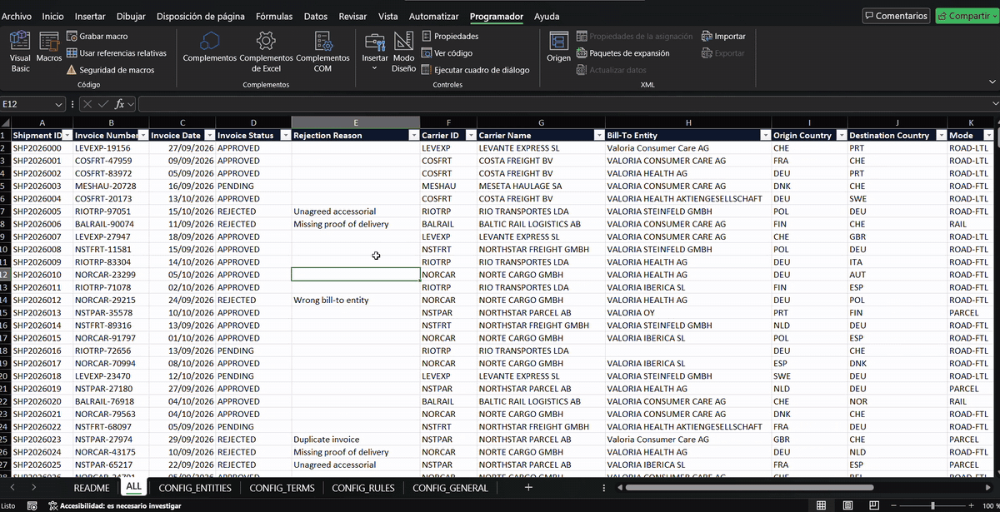
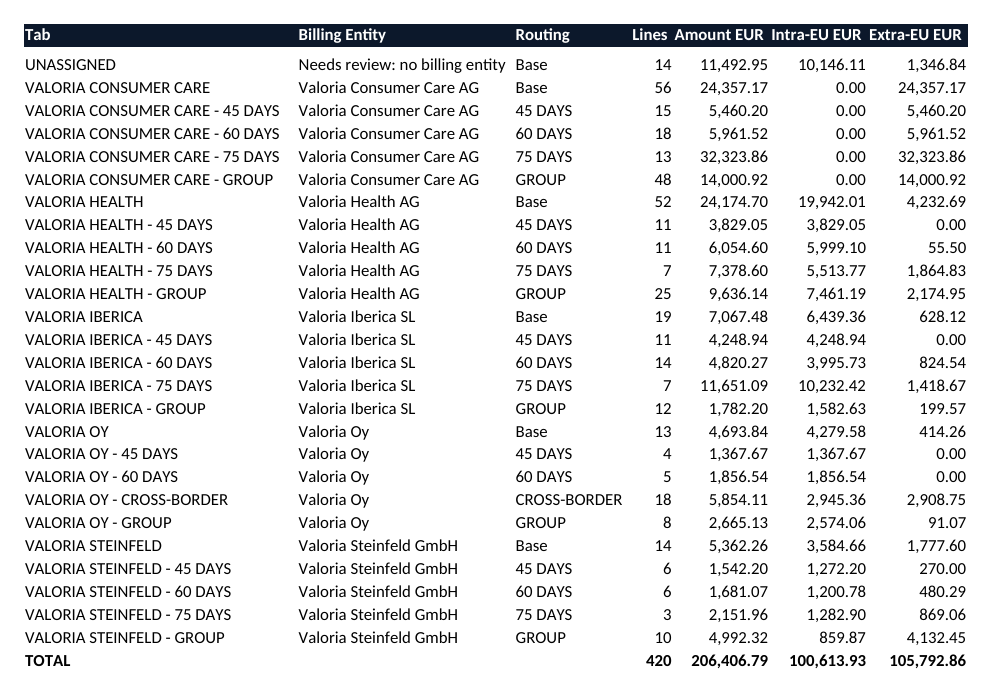
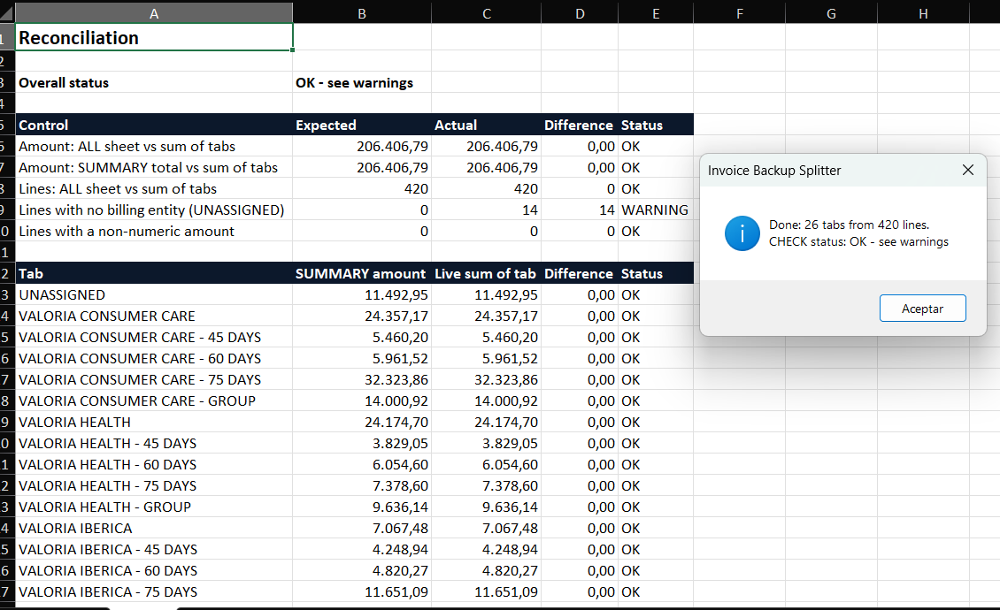

# Invoice Backup Splitter (Excel VBA)

Turns one export of carrier invoice lines into **a tab per billing entity and payment term, a reconciled summary, and one file per carrier** with its pending or rejected invoices — in two clicks.



> **All data is fictional.** The client group "Valoria", its entities, the carriers and every amount are generated by `tools/build_workbook.py`.

## Background

This is a clean-room rebuild of an invoicing process I automated at work, where the original Excel solution cut a recurring two-day task to half a day per week. The version here is generic: every company-specific rule lives in configuration sheets, not in the code, so it can be adapted without touching VBA.

## What it does

**`GenerateEntityTabs`** reads the `ALL` sheet and routes every invoice line to a tab. For each line, the first rule that applies wins:

| Priority | Rule | Example tab |
|---|---|---|
| 1 | Special rule from `CONFIG_RULES` (entity + origin + destination countries) | `VALORIA OY - CROSS-BORDER` |
| 2 | In-house group carrier (keyword in `CONFIG_GENERAL`) | `VALORIA HEALTH - GROUP` |
| 3 | Carrier payment terms from `CONFIG_TERMS` (any number of days) | `VALORIA IBERICA - 60 DAYS` |
| 4 | The entity's base tab | `VALORIA OY` |

Lines with no billing entity go to `UNASSIGNED` instead of being skipped. The macro then builds:

- **SUMMARY**: lines and amount per tab, split intra-EU / extra-EU (for VAT treatment)
- **CHECK**: live formulas that prove nothing was lost or counted twice, and that keep working if someone edits a tab by hand afterwards





**`ExportPendingInvoices` / `ExportRejectedInvoices`** write one workbook per carrier, ready to send:
`exports/20261029/20261029 MESHAU MESETA HAULAGE SA PENDING_INVOICES.xlsx`. Every file is listed in `EXPORT_LOG`.

## Configuration (no code changes needed)

| Sheet | What you set |
|---|---|
| `CONFIG_ENTITIES` | How raw entity names map to tabs (`EXACT` or `CONTAINS`) and their display names |
| `CONFIG_TERMS` | Carriers with special payment terms and their days |
| `CONFIG_RULES` | Special routing: entity + origin/destination country lists → tab suffix |
| `CONFIG_GENERAL` | Column names, in-house carrier keyword, EU country list, export folder |

## What changed from my first versions

| First versions | This version |
|---|---|
| Entity names and special rules written inside the code | All rules in `CONFIG_*` sheets, editable by anyone |
| One copy of the export macro per status and column layout | One macro with a parameter, columns found by header name |
| Carrier file opened and closed once **per row** | Lines grouped in memory, each file written once |
| Lines with no entity silently skipped | Sent to `UNASSIGNED` and flagged as a warning in `CHECK` |
| Tabs from an earlier run left behind with old data | A hidden registry removes them before each run |
| Re-running the export appended duplicate lines | Each day's file is overwritten, the source sheet is never modified |
| An error could leave Excel with screen updating and calculation switched off | Error handler always restores settings |
| `Scripting.Dictionary` (Windows only) | VBA `Collection` (also runs on Excel for Mac) |

## How I tested it

1. **Ran the real macros headless in LibreOffice's VBA mode** (`tools/test_libreoffice.py`) in English and Spanish locales, including a second run and a run after a config change.
2. **Compared every tab against an independent Python implementation** of the same rules (`tools/reference_check.py`): lines, amounts and intra-EU split per tab.
3. **Ran it in Excel for Windows with a Spanish locale.** The first two attempts surfaced the two issues at the top of the list below; after the fixes it produces exactly the same totals as the reference (screenshot above), and `ExportPendingInvoices` wrote the 8 carrier files (97 lines) with the same amount per carrier.

What testing caught:
- **Import in the VBA editor dropped a line** ("Invalid outside procedure"). The `.bas` files had Unix line endings (LF); the VBA editor expects Windows endings (CRLF). Converted, and `.gitattributes` now keeps CRLF on every download.
- **First run in a Spanish Excel stopped with "Application-defined or object-defined error".** The CHECK formulas were built by concatenating the tolerance `0.005` into the formula text, and VBA converts numbers using the local decimal separator, so Excel received `<0,005` and read the comma as an argument separator. Fixed by keeping the tolerance as text, and the LibreOffice test now also runs with a Spanish locale (`es-ES`) and fails if any formula is built this way.
- Lines from an entity written with a **non-breaking space** were not matched to their tab. Cause: `Chr(160)` is not a non-breaking space on every platform; `ChrW(160)` is. Fixed in `Norm()`.
- Appending to a log with `End(xlUp)` wrote rows over each other when another workbook was active. Replaced with `CountA`, and the tab registry is now written in one go.
- Two constructs that Excel accepts but LibreOffice does not (`New Collection` passed directly as an argument, arrays declared `As Collection`), rewritten in a form both accept.

## Results on the sample workbook

| | |
|---|---|
| Invoice lines | 420 |
| Tabs generated | 26 |
| Total amount | 206,406.79 € (100,613.93 € intra-EU, 105,792.86 € extra-EU) |
| Lines without entity | 14 (flagged as a warning) |
| Pending export | 97 lines → 8 carrier files |
| Rejected export | 45 lines → 8 carrier files |

## Use it

1. Open `InvoiceBackup_TEMPLATE.xlsx` and save it as **`.xlsm`** (macro-enabled).
2. `Alt + F11` → **File → Import File…** → import the three files in `src/`.
3. `Alt + F8` → run `GenerateEntityTabs`, then `ExportPendingInvoices` or `ExportRejectedInvoices`.

To use your own data, paste it into `ALL` (header in row 1, first column always filled) and update the `CONFIG_*` sheets.

## Project structure

```
src/modHelpers.bas          text normalisation, lookups, file and sheet names
src/modEntityTabs.bas       GenerateEntityTabs, SUMMARY, CHECK
src/modCarrierExport.bas    one file per carrier for pending / rejected invoices
InvoiceBackup_TEMPLATE.xlsx sample workbook with fictional data and config sheets
tools/build_workbook.py     generates the sample workbook
tools/test_libreoffice.py   runs the macros headless in LibreOffice
tools/reference_check.py    independent check of the results
```

## Limitations

- Sheet names are limited to 31 characters; two very long names that only differ at the end would collide.
- The amount column must contain numbers; anything else is counted in `CHECK` as non-numeric.
- The last row is detected from column A, so it must be filled on every line.

## Stack

Excel VBA. Python only to generate the sample data and to test. Built with AI assistance (Claude).
